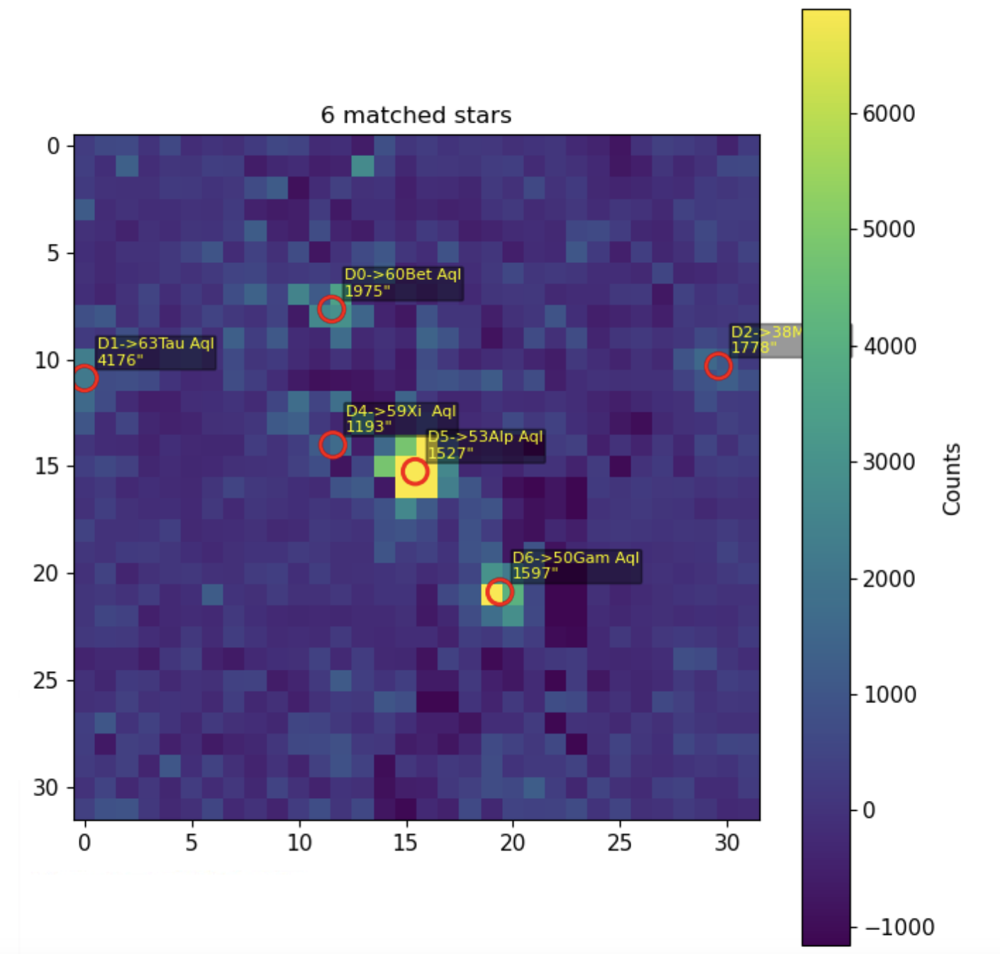
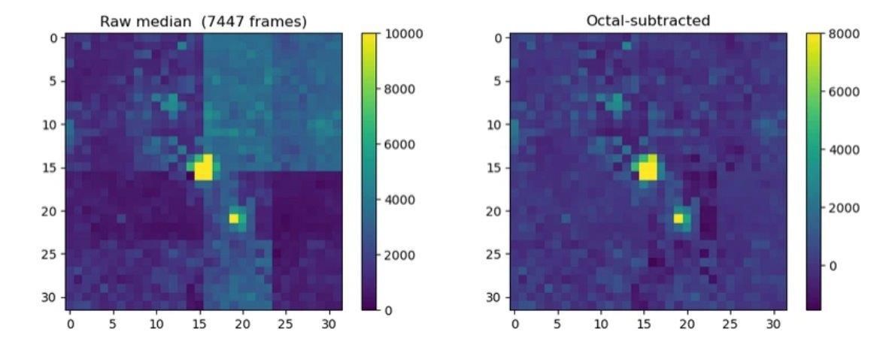
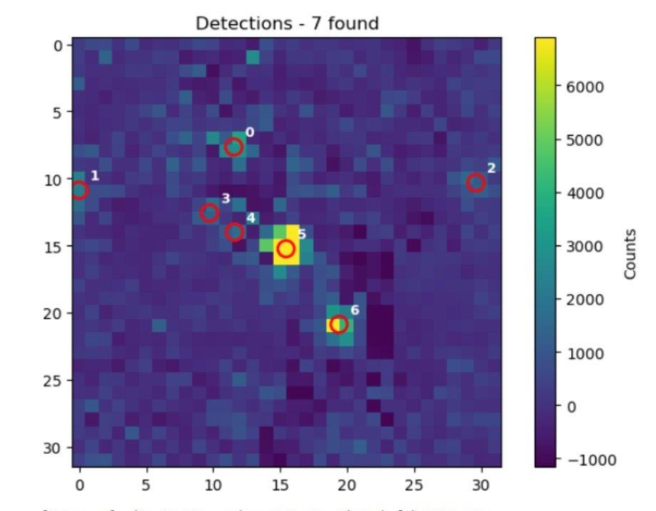
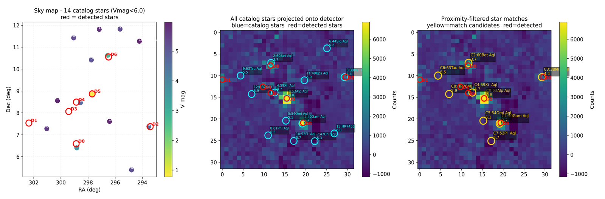

Panoramic SETI (PANOSETI) is building a wide-field observatory to search for fast optical transients, on timescales from nanoseconds to seconds. Its science spans very-high-energy gamma-ray astrophysics, fast optical transients and possible optical technosignatures. Four experimental telescopes are deployed across Palomar Observatory, separated by 143 to 597 meters.

Each telescope pairs a Fresnel lens with a 32 × 32 pixel detector covering a 10° × 10° field of view. The wide field lets PANOSETI watch a large patch of sky at once, but the Fresnel optics bend the image unevenly, so the plate scale changes across the detector. A star's measured pixel position doesn't map directly onto its true position on the sky. Without correcting that, we can't say precisely where a transient came from.

<figure class="sd-figure">
  
  <figcaption>Illustration of astrometric distortion: each arrow points from a star's catalog position to where it lands on the detector, with color showing the size of the offset.</figcaption>
</figure>

## How the pipeline works

I'm building an automated pipeline that turns raw PANOSETI imaging-mode data into a distortion map, in four stages.

**1. Clean the data.** Raw frames carry a square noise pattern from the detector readout, which I remove with median-based subtraction. I check the cleaning against simulated PANOSETI images with a realistic point-spread function.

<figure class="sd-figure">
  
  <figcaption>A raw frame stacked from 7,447 exposures with Altair near the center (left), and the same frame after octal median subtraction (right).</figcaption>
</figure>

**2. Find the stars.** On the cleaned image I locate stars and measure each one's intensity-weighted centroid, then convert detector coordinates to celestial coordinates with a gnomonic projection.

<figure class="sd-figure">
  
  <figcaption>Seven stars detected by centroiding on a cleaned frame.</figcaption>
</figure>

**3. Query the catalog.** I query VizieR for every catalog star inside the 10° × 10° field and project their known positions onto the detector with the same gnomonic projection.

**4. Match and map.** Observed stars are matched to their catalog counterparts, and the offset between measured and expected right ascension and declination is computed for each pair. Interpolating those offsets across the detector produces the distortion maps.

<figure class="sd-figure">
  
  <figcaption>Catalog positions from VizieR (blue) projected onto the detector and matched to detected stars (red), with proximity-filtered matches in yellow.</figcaption>
</figure>

## Results

The pipeline finds stars, matches them to VizieR, and measures astrometric residuals across the field. Centroiding and the gnomonic projection leave errors of about ±0.3°, roughly one detector pixel, across the 10° × 10° field. Interpolating the measured residuals gives two-dimensional distortion maps in right ascension and declination (top of page) that describe the positional error at every point on the detector.

Correcting for these maps lets PANOSETI localize optical transients more accurately, which matters both for its SETI goals and for working out where astrophysical events originate.

## Next steps

My SPURS fellowship (summer 2026) supported simulating PANOSETI imaging-mode data, which I use to test the pipeline against known inputs. Next, I'm combining distortion maps from multiple observations into a final map for each PANOSETI telescope.

## Outputs

* Poster: [*Automated astrometric distortion maps for Panoramic SETI*](/talks/2026-09-04-spurs-poster/), SPURS, UC San Diego, September 2026
* Poster: [*Characterizing Panoramic SETI astrometric distortion map*](/talks/2025-10-11-aps-far-west/), APS Far West Section, UC Santa Cruz, October 2025
* Talk: [*Characterizing Panoramic SETI astrometric distortion maps*](/talks/2025-08-14-ugsrc-talk/), Undergraduate Summer Research Conference, UC San Diego, August 2025
* Co-author on two Panoramic SETI papers in Proc. SPIE 14149 (2026); see [publications](/publications/)
